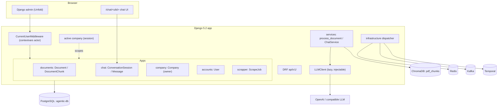
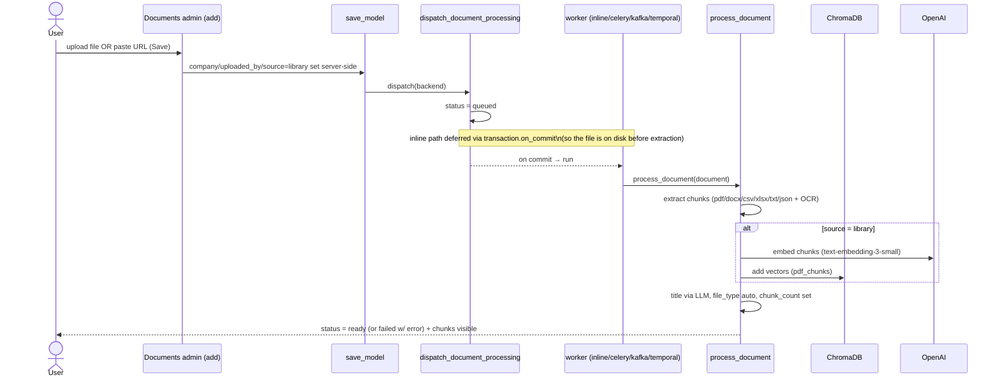
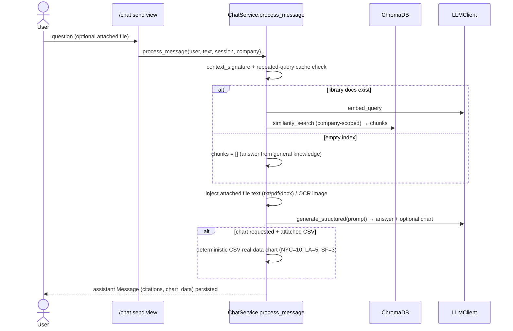
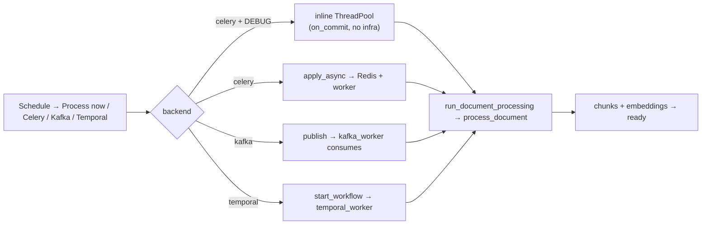
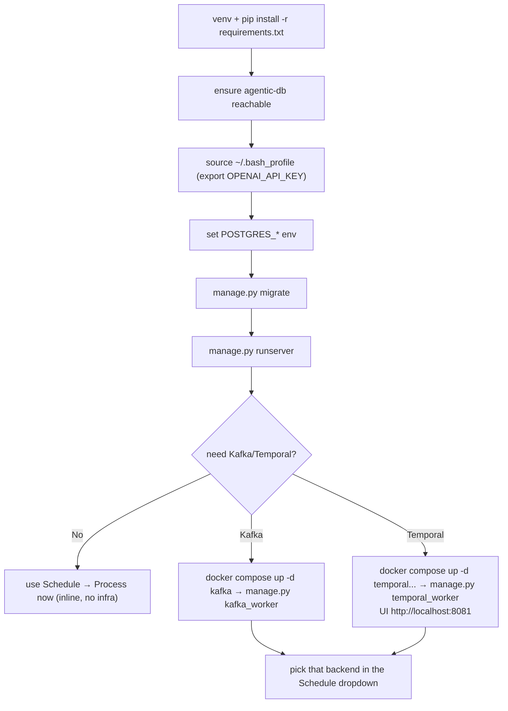

# agentic-flow

A **Django 5.2 + [django-unfold](https://unfoldadmin.com/) 0.81.0** multi-tenant AI
document platform. It is **PostgreSQL-only** and driven almost entirely through the
**Django admin** (no React), with a thin **Django REST Framework** API mounted under
`api/v1/`. The project ports the full working feature set of an older Django app —
a document library with offline extraction, OpenAI embeddings + RAG retrieval,
pluggable Celery/Kafka/Temporal processing backends, and a rich chat UX — and
re-expresses it in this project's conventions: **ULID** primary keys, soft-delete
managers, an audit `BaseModel`, a `contextvars` actor middleware, and a lazy,
injectable `LLMClient`.

Everything that touches an LLM (title derivation, embeddings, chat answers) is
**lazy and import-safe**: the app imports and runs `check` / `migrate` / the whole
test suite with no API key present.

---

## Overview

Capabilities, end to end:

- **Documents** — a document library where you upload a file **OR** paste a media
  URL (exactly one). The title is decided by the LLM from the extracted text when
  you leave it blank, and the file type is filled in automatically after processing.
- **Extraction + OCR** — PDF/DOCX/TXT/MD/CSV/XLSX/JSON plus images (PNG/JPG/TIFF),
  with a Tesseract OCR fallback for scanned PDFs and images.
- **Embeddings + RAG** — library documents are chunked, embedded with OpenAI
  `text-embedding-3-small`, and stored in ChromaDB (collection `pdf_chunks`), then
  retrieved during chat.
- **Pluggable processing** — each library row carries an in-row **Schedule**
  control (Process now / Celery / Kafka / Temporal) that dispatches through one
  backend-agnostic seam.
- **Chat** — a single-screen `/chat/<ulid>/` UI rendered inside the Unfold shell:
  session history, attach a document, citations, charts (including real-data charts
  built from an attached CSV), model switching, and delete.
- **Admin-first** — the Unfold admin is the primary UI; the DRF `api/v1/` surface
  is a thin, session-authenticated, company-scoped layer on the same models.

### Phased build + follow-ups

The project was built in phases, then refined with targeted follow-ups:

- **Phase 0 — foundations.** ULID PKs (`basics.ulid.ULIDField`), `BaseModel`
  (four audit fields), the `SoftDeleteModel` mixin + soft-delete managers, the
  `CurrentUserMiddleware` actor, and the lazy `LLMClient`.
- **Phase 1 — documents + scanning.** The `documents` app: `Document` /
  `DocumentChunk`, the offline extraction pipeline (per-format extractors + the
  word-boundary overlap chunker + Tesseract OCR fallback).
- **Phase 2 — embeddings + RAG.** `ChromaVectorStore`, batched embedding of chunks
  into the `pdf_chunks` collection, and similarity retrieval scoped by company.
- **Phase 4 — processing backends.** The `infrastructure/` dispatcher
  (celery/kafka/temporal) + Celery task + Kafka producer/consumer + Temporal
  workflow/activity, plus `docker-compose.processing.yml` and the
  `kafka_worker` / `temporal_worker` management commands.
- **Phase 3 — chat UX.** The `Message` / `MessageVersion` thread models and the
  `/chat/` single-page UI (sessions, attach, citations, charts, model switch,
  delete).
- **Follow-ups.** The minimal Documents add form (file OR URL only; LLM-decided
  title; auto file_type), and the always-present, non-clipped in-row **Schedule**
  dropdown (fixed so the menu is no longer hidden under the changelist rows).
- **Chat responsive layout.** The `/chat/` page is now a fixed, viewport-bounded
  app surface at 100% zoom (no whole-page scroll regardless of how many sessions
  exist). The Unfold shell's Tailwind flex utilities (`flex`, `flex-col`,
  `flex-1`, `min-h-0`) do not take effect on this page, so the layout is driven
  by explicit ID-based CSS in `chat/templates/chat/chat_page.html`: `#page` and
  `#main` are pinned to `100dvh`, a `min-height:0` flex chain flows that bound
  down the real content wrappers (`.chat-flex-fill`) to `#chat-layout`, and the
  two columns (`#chat-sessions-col`, `#chat-panel-col`) are explicit flex
  columns. The left **Chats** list (`#chat-session-list`) and the right
  **messages** area (`#chat-messages`) scroll internally while the composer
  (textarea + Send + attach + model select) stays pinned on screen. Verified in
  a headless Chromium at 1280×720, 1366×768, 1440×800, 1600×900, 1920×1080, and
  1024×768, plus a live resize.

---

## Architecture

### Packages

| Package | Role |
|---------|------|
| `basics` | The reusable kernel: `ULIDField` + `new_ulid`, `BaseModel` (audit) + `SoftDeleteModel`, soft-delete managers (`SoftDeleteManager` / `AllObjectsManager`), admin mixins → `BaseModelAdmin`, the lazy `LLMClient` (`basics/llm.py`), and `ChromaVectorStore` (`basics/vectorstore`). |
| `auth` (`accounts`) | The email-login `User` (`AbstractUser` + ULID). |
| `company` | The tenant root `Company` (owner-based scoping) + its admin and API. |
| `documents` | The RAG document library: `Document` / `DocumentChunk`, the extraction pipeline (`services.py`), the SSRF-safe URL download (`url_source.py`), the processing dispatch seam (`tasks.py`), and the admin add form + Schedule control. |
| `chat` | The chat thread models (`ConversationSession` / `Conversation` / `Message` / `MessageVersion`), `ChatService` (RAG + structured output + CSV charts + repeated-query cache), and the `/chat/` single-page UI. |
| `scrapper` | The SSRF-safe `ScrapeService` + `ScrapeJob`; its URL-validation policy is reused by `documents.url_source`. |
| `infrastructure` | Pluggable processing backends behind a `ProcessingDispatcher` (celery/kafka/temporal), the Kafka producer/consumer, the Temporal workflow/activity, and the Chroma vector store backend. |
| `base` | Project config: `base/settings.py`, `base/urls.py`, `base/celery.py`. |

### Model conventions

- **ULID PK** — every non-auth model declares `id = ULIDField()` (sortable,
  26-char Crockford base32).
- **`BaseModel`** — four audit fields: `created_at`, `updated_at`, `created_by`,
  `updated_by` (stamped from the `CurrentUserMiddleware` actor).
- **`SoftDeleteModel`** — a separate mixin adding `is_deleted` / `deleted_at`;
  the default manager hides soft-deleted rows, `all_objects` sees everything.
- **Required `company` FK** — every non-auth model carries a `company` FK; owner
  scoping (`company.owner == request.user`, superusers see all) is the single
  authorization axis across admin and API. Out-of-scope ids resolve to **404**.

### `documents` — the RAG library

- **`Document`** (`db_table="documents_document"`): a `source` split drives behavior
  — `library` documents are chunked **and embedded**; `chat` attachments are stored
  and read directly but **never embedded**. A library document carries **exactly one
  of** an uploaded `file` or a `source_url` (enforced in `clean()` and in the admin
  form). Processing state lives on the row: `status`
  (`uploaded`→`queued`→`processing`→`ready`/`failed`), `processing_backend`,
  `processing_stage`, `processing_progress`, `processing_task_id`,
  `processing_error`, `chunk_count`, `processing_attempts`, `processing_duration_ms`
  (with a human-readable `processing_duration_display`).
- **`DocumentChunk`** (`db_table="documents_document_chunk"`): `chunk_index`,
  `page_number`, `source_location`, `content`; unique `(document, chunk_index)`.
  The embedding vector itself lives in Chroma, not on the row (the admin reads it
  back for superusers as a truncated preview).

The extraction pipeline (`documents/services.py`) ports the older app's behavior:
constants `CHUNK_SIZE=1200` / `CHUNK_OVERLAP=180` / `TABLE_CHUNK_SIZE=9000` /
`EMBEDDING_BATCH_SIZE=96` / `EMBEDDING_WORKERS=4` / `VECTOR_BATCH_SIZE=100`,
per-format extractors (PDF/DOCX/TXT/MD/CSV/XLSX/JSON/images), word-boundary overlap
chunking, and a Tesseract OCR fallback for scanned PDFs and images. `process_document`
runs synchronously: extract → (library) embed in batched worker threads → bulk-create
chunk rows → push vectors into Chroma `pdf_chunks` → derive the title + file type →
mark `ready`; any failure removes partial chunks/vectors and marks the row `failed`
with a user-facing message.

### `chat` — the thread models + `ChatService`

- **`ConversationSession`** — the thread container (ULID `session_id`, `title`,
  `user`, per-session `model_name`), the unit the `/chat/` UI loads.
- **`Conversation`** — a question/response turn under a session; owns the
  cross-table invariant `company == session.company` in both `clean()` and `save()`.
- **`Message`** — one chat message (`user`/`assistant`/`system`) carrying `content`,
  `citations` (JSON), optional structured `chart_data` (JSON), a `documents` M2M
  (grounding/attachment), `model_name`, a `parent` self-FK for threading, and a
  `context_signature` the repeated-query cache keys on. Enforces
  `company == conversation.company`.
- **`MessageVersion`** — a historical content revision (edit/regenerate trail),
  unique `(message, version)`.

`ChatService` runs the RAG pipeline: compute the context signature → serve a cached
answer when an identical question runs against unchanged document context →
retrieve the top chunks from Chroma (company-scoped) → build the grounded prompt +
citations → ask the LLM for a structured `ChatCompletion` (prose + optional
`ChartData`: pie/bar/line) → scrub any leaked chart JSON from the prose → fall back
to a deterministic **CSV-distribution chart** built directly from a chat-attached CSV
when the model returns no chart → persist the user + assistant `Message` pair →
retitle the session from the first message.

### `infrastructure` — pluggable processing

`dispatch_document_processing(document_id, backend=None)` (in `documents/tasks.py`)
is the **single routing seam**. It flips the row to `queued` so the UI observes the
transition, then routes by backend:

- **Celery (DEBUG)** — runs inline on a managed background `ThreadPoolExecutor`
  (no Redis/worker needed); this is the default local path.
- **Celery (prod)** — `process_document_task.apply_async` to a real worker.
- **Kafka / Temporal** — `ProcessingDispatcher.from_name(...)` publishes a request
  that a worker consumes; every path converges on the same `process_document`.

`ChromaVectorStore` (`basics/vectorstore`) uses a local `PersistentClient` at
`CHROMA_PATH` (gitignored `chroma_data/`) or an `HttpClient` when `CHROMA_HOST` is
set; collection `pdf_chunks`, cosine space.

### The injectable `LLMClient`

`basics.llm.get_llm_client()` returns a provider-agnostic client wrapping
`langchain_openai`. It is **lazy**: the backend (`ChatOpenAI` / `OpenAIEmbeddings`)
is only constructed on the first `complete()` / `embed_*()` call, so importing the
module and running `check`/`migrate`/tests never needs a key. It raises
`LLMConfigurationError` when no key is configured (callers catch this for the no-key
title fallback) and `LLMBackendError` when a provider call fails. The contract is
narrow: `complete([{role, content}, ...]) -> str`, `embed_documents`, `embed_query`,
and `generate_structured` for the chat's structured output.

---

## Setup

Prerequisites: Python 3.10+, a reachable PostgreSQL, a database named `agentic-db`,
and (for OCR of scanned PDFs/images) the system packages `tesseract-ocr` and
`poppler-utils`.

```bash
cd /home/auriga/learnings/agentic-flow

# 1. Virtualenv + dependencies (single, pinned requirements.txt)
python -m venv venv
venv/bin/pip install -r requirements.txt

# 2. Configure the single .env (already present). It holds DJANGO_SECRET_KEY,
#    DEBUG, the POSTGRES_* connection, the LLM_* provider settings, CHROMA_*,
#    DOCUMENT_PROCESSING_BACKEND, and the Kafka/Temporal addresses. There is
#    intentionally NO .env.example / sample / template file.

# 3. Create the database once (run by a Postgres superuser):
#    CREATE DATABASE "agentic-db" OWNER aiplatform;

# 4. Migrate and create an admin user
venv/bin/python manage.py migrate
venv/bin/python manage.py createsuperuser   # prompts for email, then username

# 5. Run the dev server; the admin is the primary UI
venv/bin/python manage.py runserver
# -> http://127.0.0.1:8000/admin/   (chat at http://127.0.0.1:8000/chat/)
```

### The OpenAI key convention

The LLM key is read from the environment. On this machine the `OPENAI_API_KEY` is
exported from `~/.bash_profile` (a hidden file in the home directory), and the
settings resolve the key as `LLM_API_KEY` → `OPENAI_API_KEY` → `AI_API_KEY`. The app
runs fine with no key (import-safe/lazy), but LLM-decided titles, embeddings, and
chat answers only work when a key is present in the **server shell**:

```bash
source ~/.bash_profile          # exports OPENAI_API_KEY into the shell
venv/bin/python manage.py runserver
```

Without a key, library processing fails with a clear "LLM key required to embed…"
message and the chat `send` returns a 503 "LLM not configured".

---

## Features & usage

### Documents — upload a file OR a URL

Open **Documents → Documents → Add**. The add form is intentionally minimal: you
only choose a **file** or paste a **media URL** (exactly one). Everything else is
server-side:

- **Title** — left blank, it is decided by the LLM from the extracted text; with no
  key it falls back to the file name stem (or the URL host).
- **File type** — filled in automatically after processing, from the file suffix.
- **Source / tenant / audit** — the row is stamped as a `library` document, owned by
  the signed-in user and their company; none of this is shown on the add form.
- **URL downloads** — a `source_url` document is downloaded in the background by the
  scrapper's **SSRF-safe** policy (scheme/host/port allow-list, no credentials,
  rejection of private/loopback/reserved IPs, no redirects, size cap) and then runs
  through the same extraction pipeline.

On save the document is dispatched for processing; in DEBUG the default Celery path
runs inline so chunks appear almost immediately, and a changelist poller surfaces a
completion toast when the row flips to `ready`/`failed`. Use the per-row **Show**
button to view the extracted chunks (and, as a superuser, the embedding vector
preview read back from Chroma).

### Processing backends — the in-row Schedule control

Every library row shows a **Schedule** column with an **Action** button. Clicking it
opens a small dropdown — **Process now**, **Celery**, **Kafka**, **Temporal** —
pinned with `position: fixed` so it is never clipped by the changelist (the earlier
"menu goes under the list line" issue is fixed). The control appears for **every**
library row regardless of status, so a `ready` document can be **reprocessed**;
selecting an option POSTs to a CSRF-protected, owner-scoped endpoint and updates the
row's status without a page reload. "Process now" uses the row's current/default
backend; the others set `processing_backend` and dispatch through that backend.
Each document row shows the current processing stage, percent complete, and
percent remaining beneath its title; these values refresh automatically while
the document is running. **Scrapper → Queue messages** opens the scoped live
queue view for queued/running jobs and recent failures, including backend,
task ID, progress, and errors.
The action acknowledges the request immediately with a **Task queued** notice and
sets the row to **Queued**; broker startup/connection does not block the admin
click. If dispatch fails, the document changes to **Failed** with the error shown
on its detail page. The Documents list is the queue view: queued rows show the
selected backend, and the existing completion notice reports when processing
finishes.

Kafka and Temporal need their infrastructure and a worker running:

```bash
# One command starts both isolated services and both workers in the background.
./scripts/start_processing.sh

# Kafka: start the broker, then the consumer worker
sudo docker compose -f docker-compose.processing.yml up -d kafka
venv/bin/python manage.py kafka_worker

# Temporal: start the server + its Postgres + Web UI, then the worker
sudo docker compose -f docker-compose.processing.yml up -d temporal-postgresql temporal temporal-ui
venv/bin/python manage.py temporal_worker
# Temporal Web UI: http://localhost:8081   (server :7234, Kafka :9093)

# Stop the workers and this project's containers (preserves data volumes)
./scripts/stop_processing.sh
```

The all-in-one launcher waits until Kafka and Temporal are reachable before it
starts the workers. It writes worker logs and PID files under
`~/.local/state/agentic-flow-processing/`.

`docker-compose.processing.yml` provides a project-scoped, single-broker KRaft
Kafka (`:9093`), Temporal auto-setup (`:7234`) with its own Postgres, and the
Temporal Web UI (`:8081`). These dedicated ports and generated container names let
this stack run alongside other Kafka/Temporal containers. See `START_PROCESSING.txt`
for the full local walkthrough.

### Embeddings & RAG

Library documents are embedded with `text-embedding-3-small` into the Chroma
`pdf_chunks` collection, with per-chunk metadata (`user_id`, `company_id`,
`document_id`, `chunk_id`, `page_number`, `source_location`, `file_type`). During
chat, the question is embedded and the top chunks for the active company are
retrieved and fed to the LLM as grounded context with citations.

### Chat — the single-screen UI

Open **`/chat/`** (or **`/chat/<ulid>/`** to auto-open a session). The page renders
inside the Unfold shell (left admin sidebar intact) and is fully AJAX — no page
refresh:

- **Sessions history** on the left as a **uniform, ChatGPT-style list**: every row
  is the same fixed height with consistent padding, a single-line title truncated
  with an ellipsis, and a timestamp line — no row grows or shrinks with its title.
  The LLM generates the session title from the first message as part of its
  structured response; if it does not provide a title, the first message is used
  as a readable fallback.
  Deleting a chat removes it from both the Chats list and the Unfold sidebar
  history immediately; reloading also keeps it absent because deleted sessions
  are excluded from the history query.
  Click a row to load its messages in place; the active row is highlighted and rows
  highlight on hover. **New chat** creates a session (returned as JSON, never a
  redirect).
- **Reachable composer.** The input + Send + attach + model select sit at the
  bottom of a viewport-bounded panel (`height: calc(100vh - 12rem)`, `overflow:
  hidden`), so the composer is always on screen and the transcript scrolls
  internally rather than pushing the input below the fold. On an **empty / new**
  chat the textarea is focused on load and stays usable — just type and press
  **Enter** (Shift+Enter for a newline) or **Send**, and the first send
  **auto-creates a session** so you never have to hunt for a chat to start.
- **Attach a document** to the session (stored as a `chat` document, not embedded);
  the chat reads attached files directly (e.g. CSV charts).
- **Citations** render as footnote chips under assistant answers.
- **Charts** render with Chart.js from the structured `chart_data`; a chat-attached
  CSV yields a deterministic real-data chart even when the model returns none.
- **Model switching** via a per-message model dropdown.
- **Delete**, two ways, both soft-deleting via the same scoped `/chat/<id>/delete/`
  endpoint: a **ChatGPT-style per-row control** — a `…` (more) button that appears
  on hover at the right edge of each left-list row and opens a small menu with a
  **Delete** item (confirm → POST → the row is removed and the next session / empty
  state opens); and the **top-right** delete control on the open conversation's
  title. The `…`/menu click `stopPropagation()`s so it never also loads the row,
  only one row menu is open at a time, and clicking away closes it. All delete icons
  render as inline SVG (never literal ligature text).

All client rendering uses `textContent` / `createElement` / `appendChild` (never
`innerHTML`); every POST carries the CSRF token; out-of-scope session/company ids
resolve to 404.

---

## Global company switcher (active company)

The project is multi-tenant on an **owner** basis: a company's `owner` FK decides
access, and a **superuser** may act within any active company. The **active
company** is the one your admin pages and the `/chat/` surface currently operate
within. It is pure **session state** — `request.session["active_company_id"]` —
with **no model/schema change and no migration**.

- **Where it shows.** A company `<select>` is rendered in the **Unfold header**
  (top-right) on **every** admin page and on `/chat/`, via a project override of
  Unfold's `unfold/helpers/userlinks.html` (served from `base/templates/`, which is
  on `TEMPLATES["DIRS"]`) plus the `company.context_processors.active_company`
  context processor. It only appears when you can access **more than one** company;
  with exactly one it shows the company name as static text, and with none it shows
  nothing.
- **How it resolves** (`company/active.py`):
  - `allowed_companies_for_user(user)` — the companies you may access: **all active
    companies** for a superuser, otherwise the **active companies you own**
    (newest first).
  - `can_switch_company(user)` — true when that set has more than one company.
  - `active_company_for_request(request)` — returns the valid session selection, or
    pops an invalid one and **auto-selects** the most-recent accessible company
    (writing it back to the session), or `None` when you have no accessible company.
- **Switching.** Changing the header `<select>` POSTs to
  **`/company/set-active-company/`** (`company:set_active_company`, login-required,
  POST-only, CSRF-protected). The view validates that you may access the chosen
  company before storing it, then reloads the current page (or returns JSON for an
  AJAX call). You can never switch to a company you cannot access (403).
- **What follows the active company.**
  - **Admin changelists** (Documents, Document chunks, Scrape jobs, Chat models)
    show only the **active company's** rows — for superusers too (a system admin
    sees the active company's data, not every company's). The **Companies**
    changelist itself stays owner-scoped so you always see the full set to switch
    between.
  - **Add forms** default the (hidden) `company` to the active company and stamp it
    server-side, preserving the NOT-NULL `company` guarantee.
  - **`/chat/`** uses the **same session key**: the chat company selector preselects
    the active company and writes back to it on change, and a **new chat session**
    is created under the active company.
- **No accessible company.** Everything degrades cleanly (never a 500): changelists
  return an empty list, the admin add POST yields a clean `PermissionDenied` (403)
  instead of an `IntegrityError`, the header switcher renders nothing, and `/chat/`
  shows its "No companies available" empty state.

---

## Admin learning map

The admin is the primary UI and follows one house style across apps (a date-drill
bar, a search bar, a Filters button, a short ID column, a colored status badge, and
Unfold `actions_row` pill buttons that operate only on the permission-scoped
queryset with CSRF-validated POSTs):

| Goal | Where it shows up |
|------|-------------------|
| Reusable admin base | `basics/admin.py` → `BaseModelAdmin` (Unfold `ModelAdmin` + soft-delete visibility, owner scoping, audit stamping, actor auto-fill). |
| Per-app template overrides | App-local templates under `templates/admin/<app>/<model>/` (e.g. the documents `change_list.html` adds the status poller; the chunks `chunks.html` renders the scoped JSON). |
| Custom admin URLs + AJAX | `DocumentAdmin.get_urls()` adds `status-json/`, `<pk>/dispatch/`, `<pk>/chunks-json/`, and `<pk>/chunks/`, each wrapped in `admin_site.admin_view` and resolved from the scoped queryset only. |
| Row/in-row actions | The **Show** pill (chunk viewer) and the in-row **Schedule** dropdown (process/reprocess via celery/kafka/temporal). |
| Scrapper confirmation page | `scrapper.ScrapeJob`'s admin adds a CSRF-protected `run/` page invoking the SSRF-safe scrape service. |

> Templates live **app-locally** under each app's `templates/admin/<app>/<model>/`
> with `APP_DIRS=True` and no central `DIRS`.

---

## API endpoints (`api/v1/`)

DRF, mounted under `api/v1/<app>/`. Auth is **SessionAuthentication +
BasicAuthentication** with `IsAuthenticated`. Every queryset and every submitted
relation is scoped to the request user by company ownership (superusers see all);
server-controlled fields are read-only and out-of-scope ids return **404**.

| Method | Path | Behavior |
|--------|------|----------|
| GET | `api/v1/auth/user/me/` | The authenticated user (password never exposed). |
| GET/POST | `api/v1/company/company/` | List companies owned by the user; create one (`owner`/`created_by` forced to the request user). |
| GET/POST | `api/v1/chat/conversation-session/` | List/create the user's chat sessions (user + audit forced; company resolved by the required-company rule; `session_id` auto). |
| POST | `api/v1/chat/conversation/ask/` | Body `{session, question}`; resolves the session by ownership (404 if out of scope), runs the chat pipeline, returns the created turn. |
| GET/POST | `api/v1/documents/document/` | List/create documents (scoped; `uploaded_by` forced server-side). |
| GET | `api/v1/documents/document/<ulid>/chunks/` | List a document's chunks (scoped). |
| POST | `api/v1/documents/document/<ulid>/process/` | Re-run synchronous extraction; **409** for a non-library document. |
| GET/POST | `api/v1/scrapper/scrape-job/` | List/create scrape jobs (`url` + optional `title`; audit forced; status defaults to `pending`). |
| POST | `api/v1/scrapper/scrape-job/<uuid>/run/` | Run the SSRF-safe scrape; expected failures surface as an `error` job (HTTP 200). |

**Required-`company` resolution** on create (sessions, scrape jobs): a supplied
`company` must be one the user owns (else **400**); if omitted it defaults to the
user's single owned company; owning zero or more than one company without
specifying is a **400**.

---

## LLM provider: OpenAI vs DeepSeek (pure env swap)

The LLM is reached through a single provider-agnostic `LLMClient` wrapping an
OpenAI-compatible chat client. Switching providers is **config only** — no code
change — by editing `.env`:

```ini
# OpenAI (default)
LLM_PROVIDER=openai
LLM_MODEL=gpt-4o-mini
LLM_BASE_URL=
# the key is read from LLM_API_KEY, else OPENAI_API_KEY, else AI_API_KEY
LLM_API_KEY=sk-...
```

```ini
# DeepSeek (OpenAI-compatible endpoint)
LLM_PROVIDER=deepseek
LLM_MODEL=deepseek-chat
LLM_BASE_URL=https://api.deepseek.com
LLM_API_KEY=sk-...
```

Because the backend is only constructed on the first `complete()` / embedding call,
the app runs `check` / `migrate` and the whole test suite with **no key set**
(tests inject a fake client).

---

## Verification

Run from the project root with the `POSTGRES_*` env on **every** `manage.py` call and
reuse the test DB with `--keepdb`.

```bash
cd /home/auriga/learnings/agentic-flow

# No-key gate: check + makemigrations --check + migrate succeed with no LLM key
env -u OPENAI_API_KEY -u AI_API_KEY -u LLM_API_KEY \
  POSTGRES_DB=agentic-db POSTGRES_USER=aiplatform POSTGRES_PASSWORD=aiplatform123 \
  POSTGRES_HOST=localhost POSTGRES_PORT=5432 \
  venv/bin/python manage.py check

env -u OPENAI_API_KEY -u AI_API_KEY -u LLM_API_KEY \
  POSTGRES_DB=agentic-db POSTGRES_USER=aiplatform POSTGRES_PASSWORD=aiplatform123 \
  POSTGRES_HOST=localhost POSTGRES_PORT=5432 \
  venv/bin/python manage.py makemigrations --check --dry-run   # reports no changes

POSTGRES_DB=agentic-db POSTGRES_USER=aiplatform POSTGRES_PASSWORD=aiplatform123 \
  POSTGRES_HOST=localhost POSTGRES_PORT=5432 \
  venv/bin/python manage.py migrate

# Targeted tests (reuse the test DB)
POSTGRES_DB=agentic-db POSTGRES_USER=aiplatform POSTGRES_PASSWORD=aiplatform123 \
  POSTGRES_HOST=localhost POSTGRES_PORT=5432 \
  venv/bin/python manage.py test documents --keepdb

# Full suite (run once before hand-off) — currently 174 tests
POSTGRES_DB=agentic-db POSTGRES_USER=aiplatform POSTGRES_PASSWORD=aiplatform123 \
  POSTGRES_HOST=localhost POSTGRES_PORT=5432 \
  venv/bin/python manage.py test --keepdb

# DB reachable
PGPASSWORD=aiplatform123 psql -h localhost -p 5432 -U aiplatform -d "agentic-db" -tc "SELECT 1"
```

The full suite currently reports **`Ran 174 tests ... OK (skipped=1)`**.

---

## Complete flow (diagrams)

### System architecture



### Document upload → ready (with the on-commit fix)



### Chat message → answer (RAG + attachments + charts)



### Processing backend routing



---

## Before running (prerequisites & startup)

### 1. Base app (always required)

```bash
cd /home/auriga/learnings/agentic-flow
python3 -m venv venv
venv/bin/pip install -r requirements.txt

# PostgreSQL-only. The DB "agentic-db" must exist and be reachable:
#   host=localhost port=5432 user=aiplatform password=aiplatform123
# (set via POSTGRES_* env / .env; optional DATABASE_URL override.)

# Secrets: the OpenAI key is read from the shell env (OPENAI_API_KEY).
# On Ubuntu it lives in ~/.bash_profile — export it into the server's shell.
source ~/.bash_profile          # makes OPENAI_API_KEY available

export POSTGRES_DB=agentic-db POSTGRES_USER=aiplatform \
       POSTGRES_PASSWORD=aiplatform123 POSTGRES_HOST=localhost POSTGRES_PORT=5432

venv/bin/python manage.py migrate
venv/bin/python manage.py createsuperuser   # email is the username field
venv/bin/python manage.py runserver
```

- Admin: http://127.0.0.1:8000/admin/  •  Chat: http://127.0.0.1:8000/chat/
- **The LLM key must be exported in the shell that runs `runserver`** — otherwise
  chat answers and library embeddings fail (title derivation falls back to the
  filename). The app still imports/migrates fine with no key.

### 2. Processing backends

`DOCUMENT_PROCESSING_BACKEND` (default `celery`) sets the default; each document
can override it from the **Schedule** dropdown. What each path needs:

| Backend              | Infra needed to run                               |
|----------------------|---------------------------------------------------|
| **Celery (DEBUG)**   | **Nothing** — runs inline on a background thread (deferred until the DB commit). This is the zero-setup default. |
| **Celery (non-DEBUG)** | Redis + a Celery worker (`celery -A base.celery worker`) |
| **Kafka**            | Kafka broker (Docker) **and** `manage.py kafka_worker` |
| **Temporal**         | Temporal server (Docker) **and** `manage.py temporal_worker` |

> Documents only process into chunks when a worker for the chosen backend is
> running. If you pick Kafka/Temporal without starting its broker **and** worker,
> the document stays at **Queued**. Use **Process now** (celery/DEBUG inline) for
> zero-setup processing.

#### Kafka — start before using the Kafka backend

```bash
# Terminal 1 — broker (wait for STATUS: healthy)
sudo docker compose -f docker-compose.processing.yml up -d kafka
sudo docker compose -f docker-compose.processing.yml ps

# Terminal 2 — worker (from the project root, key exported)
DJANGO_SETTINGS_MODULE=base.settings venv/bin/python manage.py kafka_worker
#   or simply:  python manage.py kafka_worker
```

#### Temporal — start before using the Temporal backend

```bash
# Terminal 1 — server + UI (wait until healthy)
sudo docker compose -f docker-compose.processing.yml up -d \
     temporal-postgresql temporal temporal-ui
sudo docker compose -f docker-compose.processing.yml ps

# Terminal 2 — worker (from the project root, key exported)
DJANGO_SETTINGS_MODULE=base.settings venv/bin/python manage.py temporal_worker
#   or simply:  python manage.py temporal_worker
```

- Temporal Web UI: http://localhost:8081/

#### Shutting down the brokers

```bash
sudo docker compose -f docker-compose.processing.yml down
```

### Startup order (diagram)


