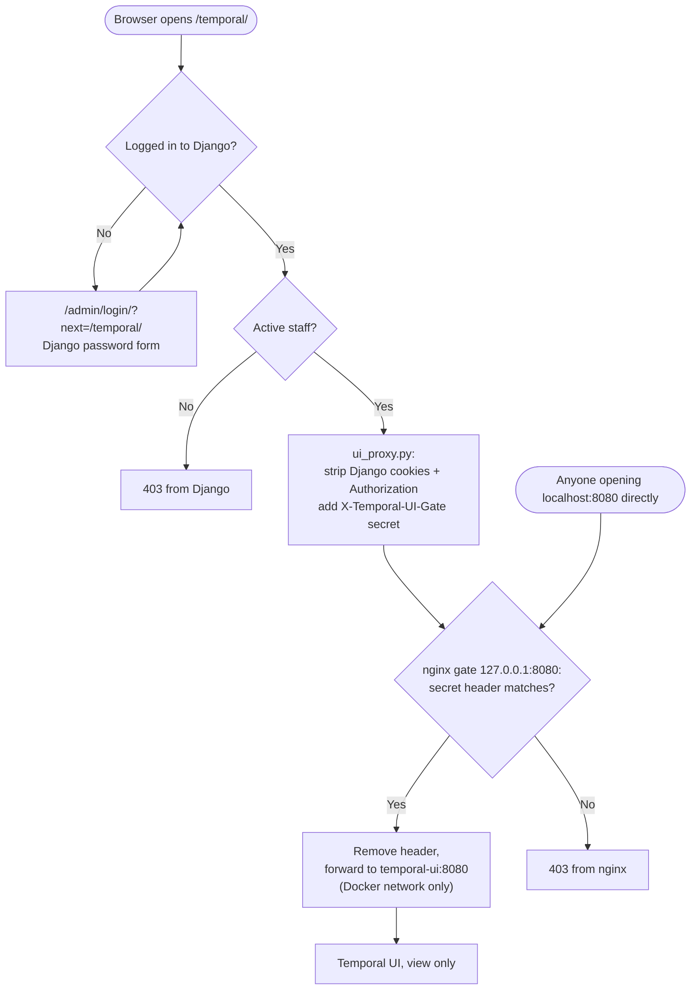

# Temporal UI access

How the Temporal Web UI is protected and who can open it.

**In short:** Temporal UI is never opened directly. It is not published on
the host at all; a small nginx gate (`temporal-ui-gate`) listens on
`127.0.0.1:8080` and returns **403** unless the request carries
`TEMPORAL_UI_PROXY_SECRET`, which only Django's proxy adds. Django passes
requests through at `/temporal/`, for **active staff users only**. Login is
the normal Django admin login; `is_staff` decides who gets in.

```
Browser ──► Django :8000 ──► nginx gate 127.0.0.1:8080 ──► Temporal UI (no host port) ──► Temporal server :7234
              │  /admin/login/  → Django admin login        checks secret header        view only, under /temporal
              │  /temporal/*    → infrastructure/temporal/ui_proxy.py  (staff check, adds secret header)
```

---

## The complete flow, end to end

Each layer has one job. Django says **who you are** (its own login) and
whether you are **staff**, and is the only thing allowed to talk to Temporal
UI. nginx makes sure **nothing except Django** can talk to Temporal UI.

| Layer | Job | Without it |
|---|---|---|
| Django admin login | Checks the password, keeps the session | No idea who the user is |
| `ui_proxy.py` | Lets only logged-in active staff through to Temporal UI and adds the gate secret | Anyone could open Temporal UI |
| nginx gate | Refuses every request without the secret | Anyone on the machine could open `:8080` and skip the login |
| Temporal UI | Shows workflows, view only | — |



### Django proxies to Temporal UI

`/temporal/…` is handled by `infrastructure/temporal/ui_proxy.py`:

1. Not logged in → redirect to `/admin/login/`. Logged in but not active
   staff → **403**.
2. Removes Django's own cookies (`sessionid`, `csrftoken`, `messages`) and the
   `Authorization`, `Host`, `Content-Length` and `Accept-Encoding` headers, so
   Temporal UI never sees the Django session.
3. Adds `X-Temporal-UI-Gate: <TEMPORAL_UI_PROXY_SECRET>` and forwards the
   request (same method and body) to `TEMPORAL_UI_URL` +
   `/temporal/<path>?<query>`, which is the nginx gate.
4. Streams the answer back. Every `Set-Cookie` from Temporal is passed
   through, and redirects that point at the internal address are rewritten.
5. If Temporal UI does not answer, you get **502** "Temporal UI is
   unavailable". The rest of Django keeps working.
6. Only this view skips Django's CSRF check (`csrf_exempt`). Temporal UI
   checks CSRF itself.

### nginx gate (why and how)

**Why.** Temporal UI has **no login of its own**. Anyone who can reach it sees
every workflow, including document IDs, company IDs and user IDs in the
inputs. Binding it to `127.0.0.1` keeps other machines out, but any program
or browser **on the same machine** could still open `http://localhost:8080`
and skip the Django login completely. Django runs on the host (not inside
Docker), so it needs a host port to reach Temporal UI. The gate closes that
hole while keeping the port.

**How.**

- The `temporal-ui` container is **not published** on the host at all. Only
  containers on the same Docker network can reach it.
- The `temporal-ui-gate` container (`nginx:1.27-alpine`) is published on
  `127.0.0.1:8080`. Its config is
  `infrastructure/temporal/ui_gate.conf.template`.
- When the container starts, the nginx image fills `${TEMPORAL_UI_PROXY_SECRET}`
  into the config from the container environment, which Compose takes from
  `.env`.
- For every request, nginx compares the `X-Temporal-UI-Gate` header with the
  secret:
  - **Missing or wrong:** `403`. The request never reaches Temporal UI.
  - **Correct:** nginx removes the header and forwards the request to
    `http://temporal-ui:8080` inside the Docker network, with buffering off so
    pages stream.
- Only Django's proxy knows the secret, and it adds the header **only after**
  the staff check. A browser opening `:8080` directly never has it.

The same secret must be in Django's `.env` and in the gate container. After
changing it, run `docker compose -f docker-compose.processing.yml up -d` and
fully restart `runserver`.

### Temporal UI

Temporal UI runs under `/temporal` (`TEMPORAL_UI_PUBLIC_PATH`), so its paths
match the proxied ones, and **view only** (`TEMPORAL_DISABLE_WRITE_ACTIONS`).
It talks to the Temporal server over gRPC inside the Docker network.

---

## 1. Start everything locally

```bash
# 1. Temporal server, Temporal UI, the nginx gate (and Kafka)
docker compose -f docker-compose.processing.yml up -d

# 2. Django
python manage.py runserver
```

| Service | URL |
|---|---|
| Django admin | http://localhost:8000/admin/ |
| Temporal UI (use this) | **http://localhost:8000/temporal/** |
| Temporal UI direct | http://localhost:8080/temporal/ returns **403** (blocked by the gate) |

> Opening `http://localhost:8080` directly always returns 403, even when you
> are logged in. That is expected: use `http://localhost:8000/temporal/`.

After changing `.env`, **fully restart** `runserver`. The auto-reloader does
not pick up `.env` changes.

---

## 2. Settings (`.env`)

| Variable | Example | Meaning |
|---|---|---|
| `SESSION_COOKIE_SECURE` / `CSRF_COOKIE_SECURE` | `False` locally | Default `True`. Set to `False` only for plain-http local development. |
| `USE_X_FORWARDED_PROTO` | `True` in production | Set only when Django sits behind an HTTPS proxy that sets this header |
| `TEMPORAL_UI_URL` | `http://localhost:8080` | Internal address of the Temporal UI gate, used only by the proxy |
| `TEMPORAL_UI_PROXY_SECRET` | *(random)* | Shared by the Django proxy and the `temporal-ui-gate` container. Without it every Temporal page is 403. Never commit it. |
| `TEMPORAL_UI_PROXY_TIMEOUT_SECONDS` | `30` | How long the proxy waits for Temporal UI |

---

## 3. Who can do what

| Django user | Can open |
|---|---|
| normal user (`is_staff` off) | chat and agents; can start processing (including Temporal) from chat and see its status there, but **cannot** open Temporal UI |
| `is_staff` on | Django admin + Temporal UI (view only) |
| `is_staff` + `is_superuser` | everything |

- Create users with `python manage.py createsuperuser`, or in **Admin →
  Users**. Tick **Staff status** to give Temporal UI access; untick it to
  take it away (effective on the next request).
- Temporal UI is **view only** for everyone (`TEMPORAL_DISABLE_WRITE_ACTIONS=true`):
  no cancel, terminate, reset or signal.

### Where the Temporal links appear

| Place | Source |
|---|---|
| Admin header, "Temporal workflows" | `base/templates/unfold/helpers/userlinks.html` (staff only) |
| Documents admin, "See workflow" | `documents/admin.py → temporal_link` |
| Chat file panel and replies, "Workflow" | `chat/services/session_files.py → file_row` + `chat/templates/chat/chat_page.html` (shown only when `is_active and is_staff`) |

All links are built by `chat/services/kb.py → temporal_ui_url` as
`/temporal/namespaces/default/workflows/doc-<document id>`. Hiding a link is
cosmetic; the staff check in `ui_proxy.py` and the nginx gate are what block
access.

### Starting and following a workflow

Starting a workflow and viewing it in Temporal UI are separate permissions.
Every document has one workflow id, `doc-<document id>`.

| Where | Who | Start | Follow progress | Workflow link |
|---|---|---|---|---|
| Documents admin, **Action → Temporal** | staff | `<pk>/dispatch/` → `enqueue_document_processing(..., backend="temporal")` | progress bar and status, polled every 4 s (`status_poll.js`) | "See workflow" appears **as soon as** the dispatch returns (the JSON carries `temporal_url`); the poll adds it too if missing |
| Chat, "add this file to the knowledge base" | any logged-in chat user | `add_to_knowledge_base` tool → same `enqueue_document_processing` | status replies and the file panel | shown only to staff; non-staff see the status and the workflow id as text, and opening `/temporal/…` gives them 403 |

Controls in the documents admin:

- **Stop** (`<pk>/temporal-cancel/`, queued or processing only): terminates the
  running workflow and marks the document failed with "Processing stopped by
  user." Completed stages and chunks are kept.
- **Retry** (`<pk>/temporal-retry/`, failed only): starts a new run of
  `doc-<id>`. Completed stages are skipped, so it **resumes** at the stage that
  failed.
- Choosing another backend from **Action** removes the "See workflow" link
  straight away.

---

## 4. Files

| File | Role |
|---|---|
| `base/settings.py` | Cookie security, proxy settings, logging |
| `base/urls.py` | `temporal/` route to the proxy |
| `infrastructure/temporal/ui_proxy.py` | Staff-only proxy to Temporal UI |
| `docker-compose.processing.yml` | Temporal UI `2.34.0` (no host port), gate on `127.0.0.1:8080`, gRPC on `127.0.0.1:7234` |
| `infrastructure/temporal/ui_gate.conf.template` | nginx gate: 403 unless the secret header matches |

---

## 5. Checks

| # | Do | Expected |
|---|---|---|
| 1 | Open `/temporal/` in a private window | Sent to `/admin/login/`, then back to Temporal UI |
| 2 | Log in as a user without staff status | Chat works; `/temporal/` gives 403 |
| 3 | Log in as a staff user | Admin and Temporal UI open; workflows are listed |
| 4 | Untick a user's staff status, reload `/temporal/` | 403 |
| 5 | Stop the `temporal-ui` container, open `/temporal/` | 502 page; Django still works |
| 6 | From another machine: `curl http://<server-ip>:8080/temporal/` | Connection refused |
| 7 | On this machine: `curl -i http://localhost:8080/temporal/` | 403 from nginx |

---

## 6. Troubleshooting

| Problem | Cause / fix |
|---|---|
| `/temporal/` shows a blank white page | Temporal UI older than 2.27 breaks under `/temporal` (its Content Security Policy blocks its own startup script). Use `temporalio/ui:2.34.0` or newer. Hard-refresh with Ctrl+Shift+R. |
| `localhost:8080` shows 403 | Expected. Use `localhost:8000/temporal/`. |
| `localhost:8000/temporal/` shows 403 for a staff user | `TEMPORAL_UI_PROXY_SECRET` missing or different between `.env` and the gate. Fully restart `runserver` and `docker compose -f docker-compose.processing.yml up -d`. |
| Login does nothing / admin forms fail on http | `SESSION_COOKIE_SECURE` / `CSRF_COOKIE_SECURE` are `True` on plain http. Set them to `False` locally. |
| 405 in the browser console on a workflow page | Normal. Write actions are disabled, so Temporal UI refuses its metadata query. |
| `.env` change has no effect | Fully restart `runserver`. |
| 502 "Temporal UI is unavailable" | `docker compose -f docker-compose.processing.yml up -d temporal-ui` |

---

## 7. Production notes

- Never publish port 8080 or 7234 publicly, and never point a public nginx
  route at 8080 (the gate is internal; the public route is Django's
  `/temporal/`). Docker-published ports bypass `ufw`, so keep the `127.0.0.1:`
  prefix.
- Generate a fresh `TEMPORAL_UI_PROXY_SECRET` for each environment. If Django
  runs inside the same Docker network, you can drop the gate's host port and
  point `TEMPORAL_UI_URL` at `http://temporal-ui-gate:8080`.
- Serve the site over HTTPS only. Keep the secure-cookie settings at their
  default `True`, and set `USE_X_FORWARDED_PROTO=True` behind a proxy.
- Bind Kafka's `9093` to `127.0.0.1` as well. It is still public in
  `docker-compose.processing.yml`.
- Review who has staff status regularly.
