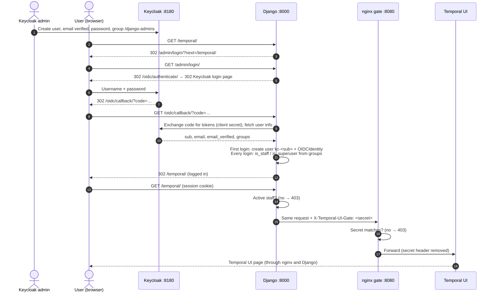
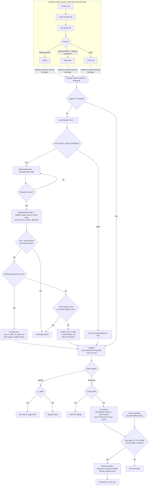

# Temporal UI access and Keycloak login

How the Temporal Web UI is protected, how Django admin login works with
Keycloak, and how to add new users.

**In short:** Temporal UI is never opened directly. It is not published on
the host at all; a small nginx gate (`temporal-ui-gate`) listens on
`127.0.0.1:8080` and returns **403** unless the request carries
`TEMPORAL_UI_PROXY_SECRET`, which only Django's proxy adds. Django passes
requests through at `/temporal/`, for **active staff users only**. Keycloak decides who is staff
(through groups); Django enforces it.

```
Browser ──► Django :8000 ──► nginx gate 127.0.0.1:8080 ──► Temporal UI (no host port) ──► Temporal server :7234
              │  /admin/login/  → auth/views.py            checks secret header        view only, under /temporal
              │  /oidc/*        → mozilla-django-oidc
              │  /temporal/*    → infrastructure/temporal/ui_proxy.py  (adds secret header)
              │
              └──► Keycloak :8180   (only when KEYCLOAK_LOGIN_ENABLED=True)
```

---

## The complete flow, end to end

Each layer has one job. Keycloak says **who you are** and **which groups you
are in**. Django turns that into a Django user, decides whether you are
**staff**, and is the only thing allowed to talk to Temporal UI. nginx makes
sure **nothing except Django** can talk to Temporal UI.

| Layer | Job | Without it |
|---|---|---|
| Keycloak | Stores users, passwords and groups. Checks the password. | Users and passwords live in Django |
| Django + `auth/oidc.py` | Creates or finds the Django user, sets `is_staff` / `is_superuser` from the groups | Keycloak groups would mean nothing to the app |
| `ui_proxy.py` | Lets only logged-in active staff through to Temporal UI and adds the gate secret | Anyone could open Temporal UI |
| nginx gate | Refuses every request without the secret | Anyone on the machine could open `:8080` and skip the login |
| Temporal UI | Shows workflows, view only | — |



The same flow as decisions: every place a request can be stopped, and why.



### Stage 1: Create the user in Keycloak

An admin creates the user in the **agentic-flow** realm (section 4). Three
things matter to Django later:

- **Email verified = ON.** Django refuses the login otherwise.
- **Group.** `/django-admins` becomes `is_staff`; `/django-superusers` becomes
  `is_superuser`. No group = chat only.
- **ID (`sub`).** Keycloak gives every user a permanent ID, for example
  `0dcd0ab1-fd68-…`. Django remembers the user by this ID, never by email.

Nothing is sent to Django at this point. Keycloak and Django do not sync users
in the background.

### Stage 2: The user opens a protected page

The user opens `/temporal/` (or `/admin/`). They are not logged in, so Django
sends them to `/admin/login/?next=/temporal/`. With
`KEYCLOAK_LOGIN_ENABLED=True`, `auth/views.py → admin_login` does not show a
password form. It sends them to `/oidc/authenticate/`, which redirects to the
Keycloak login page with a random `state` and `nonce` saved in the session.

### Stage 3: Keycloak checks the password

The user types the username and password **on Keycloak's page**. Django never
sees the password. Keycloak redirects back to
`/oidc/callback/?code=…&state=…`. The `code` is single-use and worthless
without the client secret.

### Stage 4: Django creates or updates the user

`mozilla-django-oidc` checks `state`, exchanges the `code` for tokens using
`KEYCLOAK_CLIENT_SECRET` (server to server), checks the token signature against
the realm's public keys, and fetches the user info. Then
`auth/oidc.py → KeycloakOIDCBackend`:

1. Refuses the login if `sub` or `email` is missing, or the email is not verified.
2. Looks the user up **only** by `sub` in `OIDCIdentity`.
3. **First login:** creates the Django user (`username = kc-<sub>`, email and
   names from Keycloak) and the `OIDCIdentity` row, in one transaction. If the
   email already belongs to a Django user that is not linked, the login is
   refused (link it first, section 5).
4. **Every login:** sets `is_staff` / `is_superuser` from the current groups
   and updates the names. The email is never changed by Keycloak.

The user lands back on `next` (`/temporal/`), logged in. They now show up under
**Admin → Users** and **Admin → Keycloak identities**.

Every 15 minutes `SessionRefresh` checks the user with Keycloak again. A user
disabled in Keycloak or removed from `/django-admins` loses access within 15
minutes.

### Stage 5: Django admin

`/admin/` is the normal Django (Unfold) admin. It lets the user in because
`is_staff` is `True`. What they can change inside the admin is still decided by
Django permissions; superusers can change everything. A logged-in user who is
not staff gets a "no access" page instead of a login loop.

### Stage 6: Django proxies to Temporal UI

`/temporal/…` is handled by `infrastructure/temporal/ui_proxy.py`:

1. Not logged in → redirect to login. Logged in but not active staff → **403**.
2. Removes Django's own cookies (`sessionid`, `csrftoken`, `messages`) and the
   `Authorization` header, so Temporal UI never sees the Django session.
3. Adds `X-Temporal-UI-Gate: <TEMPORAL_UI_PROXY_SECRET>` and forwards the
   request to `TEMPORAL_UI_URL` (`http://localhost:8080`, the nginx gate).
4. Streams the answer back to the browser.

### Stage 7: nginx gate (why and how)

**Why.** Temporal UI has **no login of its own**. Anyone who can reach it sees
every workflow, including document IDs, company IDs and user IDs in the
inputs. Binding it to `127.0.0.1` keeps other machines out, but any program
or browser **on the same machine** could still open `http://localhost:8080`
and skip the Django login completely. Django runs on the host (not inside
Docker), so it needs a host port to reach Temporal UI. The gate closes that
hole while keeping the port.

**How.**

- The `temporal-ui` container is **not published** on the host at all. Only
  containers on the same Docker network can reach it.
- The `temporal-ui-gate` container (`nginx:1.27-alpine`) is published on
  `127.0.0.1:8080`. Its config is
  `infrastructure/temporal/ui_gate.conf.template`.
- When the container starts, the nginx image fills `${TEMPORAL_UI_PROXY_SECRET}`
  into the config from the container environment, which Compose takes from
  `.env`.
- For every request, nginx compares the `X-Temporal-UI-Gate` header with the
  secret:
  - **Missing or wrong:** `403`. The request never reaches Temporal UI.
  - **Correct:** nginx removes the header and forwards the request to
    `http://temporal-ui:8080` inside the Docker network, with buffering off so
    pages stream.
- Only Django's proxy knows the secret, and it adds the header **only after**
  the staff check in stage 6. A browser opening `:8080` directly never has it.

The same secret must be in Django's `.env` and in the gate container. After
changing it, run `docker compose -f docker-compose.processing.yml up -d` and
fully restart `runserver`.

### Stage 8: Temporal UI

Temporal UI runs under `/temporal` (`TEMPORAL_UI_PUBLIC_PATH`), so its paths
match the proxied ones, and **view only** (`TEMPORAL_DISABLE_WRITE_ACTIONS`).
It talks to the Temporal server over gRPC inside the Docker network.

### Stage 9: Logout

`/admin/logout/` ends the Django session **and** the Keycloak session
(`auth/oidc.py → provider_logout`). The next visit to `/admin/` or
`/temporal/` asks for the password again.

### Verified

This whole flow was run end to end on 2026-11-03 against the real local
services: throwaway Keycloak users were created through the Keycloak admin
API, logged in through the real Keycloak login form, and then deleted from
both Keycloak and Django. All 23 checks passed:

| Check | Result |
|---|---|
| `/temporal/` logged out | 302 to `/admin/login/?next=/temporal/` |
| `/admin/login/` | 302 to `/oidc/authenticate/`, then to the agentic-flow realm |
| Keycloak password | 302 to `/oidc/callback/?code=…` |
| Callback | Logged in, back on `/temporal/` |
| First login, user in `/django-admins` | Django user `kc-<sub>`, `is_staff=True`, `is_superuser=False`, `OIDCIdentity` row |
| `/admin/` as staff | 200 |
| `/temporal/` and its API as staff | 200, workflows listed |
| `localhost:8080` directly | 403 from nginx |
| Logout | Redirect to Keycloak end-session; `/temporal/` asks for login again |
| User with no group | Django user with `is_staff=False`; `/temporal/` 403; `/admin/` shows "no access" |

---

## 1. Start everything locally

```bash
# 1. Temporal server + Temporal UI (and Kafka)
docker compose -f docker-compose.processing.yml up -d

# 2. Keycloak (imports the agentic-flow realm on first start)
docker compose -f docker-compose.keycloak.yml up -d

# 3. Database table for Keycloak links (once)
python manage.py migrate

# 4. Django
python manage.py runserver
```

| Service | URL |
|---|---|
| Django admin | http://localhost:8000/admin/ |
| Temporal UI (use this) | **http://localhost:8000/temporal/** |
| Temporal UI direct | http://localhost:8080/temporal/ returns **403** (blocked by the gate) |
| Keycloak admin console | http://localhost:8180 |

> Opening `http://localhost:8080` directly always returns 403, even when you
> are logged in. That is expected: use `http://localhost:8000/temporal/`.

After changing `.env`, **fully restart** `runserver`. The auto-reloader does
not pick up `.env` changes.

---

## 2. Settings (`.env`)

| Variable | Example | Meaning |
|---|---|---|
| `KEYCLOAK_LOGIN_ENABLED` | `False` | `True` sends `/admin/login/` to Keycloak. `False` = normal Django password login. |
| `KEYCLOAK_REALM_URL` | `http://localhost:8180/realms/agentic-flow` | Keycloak realm |
| `KEYCLOAK_CLIENT_ID` | `django-app` | Keycloak client used by Django |
| `KEYCLOAK_CLIENT_SECRET` | *(random)* | Shared by Django and the Keycloak container. Never commit it. Django refuses to start if it is missing while login is enabled. |
| `KEYCLOAK_ADMIN_USER` / `KEYCLOAK_ADMIN_PASSWORD` | `admin` / *(random)* | Login for the Keycloak admin console |
| `BREAK_GLASS_LOGIN_ENABLED` | `False` | `True` opens `/admin/local-login/` (emergency password login) |
| `SESSION_COOKIE_SECURE` / `CSRF_COOKIE_SECURE` | `False` locally | Default `True`. Set to `False` only for plain-http local development. |
| `USE_X_FORWARDED_PROTO` | `True` in production | Set only when Django sits behind an HTTPS proxy that sets this header |
| `TEMPORAL_UI_URL` | `http://localhost:8080` | Internal address of the Temporal UI gate, used only by the proxy |
| `TEMPORAL_UI_PROXY_SECRET` | *(random)* | Shared by the Django proxy and the `temporal-ui-gate` container. Without it every Temporal page is 403. Never commit it. |
| `TEMPORAL_UI_PROXY_TIMEOUT_SECONDS` | `30` | How long the proxy waits for Temporal UI |

---

## 3. Who can do what

Keycloak groups decide the Django roles. They are re-applied **on every
login** and re-checked **every 15 minutes**.

| Keycloak group | Django result | Can open |
|---|---|---|
| *(none)* | normal user | chat only |
| `/django-admins` | `is_staff = True` | Django admin + Temporal UI (view only) |
| `/django-admins` **and** `/django-superusers` | `is_staff` + `is_superuser` | everything |

Notes:

- A user in `/django-superusers` but **not** in `/django-admins` cannot open
  the admin. Put superusers in both groups.
- Keep `/django-superusers` to 2–3 people.
- Removing someone from a group takes effect within 15 minutes, or at their
  next login.
- Temporal UI is **view only** for everyone (`TEMPORAL_DISABLE_WRITE_ACTIONS=true`):
  no cancel, terminate, reset or signal.

---

## 4. Adding a new user

All users are created in **Keycloak**, never in Django. The Django account is
created automatically on the user's first login.

1. Open http://localhost:8180, log in with `KEYCLOAK_ADMIN_USER` /
   `KEYCLOAK_ADMIN_PASSWORD` from `.env`, and switch to the **agentic-flow** realm
   (top-left dropdown).
2. **Users → Add user**
   - **Email**: the person's email
   - **Email verified**: **ON** (otherwise the login is refused)
   - First name / Last name: optional
   - Click **Create**.
3. **Credentials** tab → **Set password**, with **Temporary** ON (they choose
   their own at first login) or OFF.
4. **Groups** tab → **Join group**:
   - `django-admins` for admin and Temporal access
   - also `django-superusers` only for full superusers
   - no group for chat-only users
5. The person opens http://localhost:8000/admin/ (or `/chat/`), signs in at
   Keycloak, and is sent back logged in. Django creates the user as
   `kc-<Keycloak ID>`.

**Check:** in Keycloak, **Clients → django-app → Client scopes → Evaluate**,
pick the user, then **Generated user info**. It must show
`"email_verified": true` and `"groups": ["/django-admins"]`.

### The email already exists in Django

Django logins are matched by the Keycloak **user ID (`sub`)**, never by email.
This blocks someone from taking over an account just by registering its email
in Keycloak. So if the new Keycloak user's email already belongs to a Django
account, the login is **refused** ("Login failed") until you link the two
accounts (next section).

---

## 5. Linking existing Django users

Do this once for each person who already had a Django account before Keycloak.

1. Create the Keycloak user with the **same email** (section 4, steps 1–4).
2. Copy their **ID** from the Keycloak user page (e.g. `c42b5810-ad03-...`).
3. Write a CSV file:

   ```csv
   username,sub
   lokesh,c42b5810-ad03-4089-b6c0-240d73ed450d
   ```

   `username` is the Django **username** field (not the email). Check it under
   **Admin → Users**.
4. Preview, then apply:

   ```bash
   python manage.py link_keycloak_identities admins.csv --dry-run
   python manage.py link_keycloak_identities admins.csv
   ```

   The command checks the whole file first. It changes **nothing** if any row
   has an unknown user, a user or ID that is already linked, or a duplicate.
5. Do **not** link the break-glass account (section 8).

---

## 6. Switching Keycloak login on

1. Link all existing admins (section 5).
2. Set `KEYCLOAK_LOGIN_ENABLED=True` in `.env`.
3. Fully restart `runserver`.
4. Test with one admin and one non-admin user (section 10).

To switch back: set it to `False` and restart. The old password login works
again, and no data changes.

---

## 7. What happens on each request

### Login (flag on)

1. You open `/admin/` or `/temporal/` and are not logged in, so you are sent to
   `/admin/login/?next=…`.
2. `auth/views.py → admin_login` checks that `next` points to this site and
   redirects to `/oidc/authenticate/`.
3. `mozilla-django-oidc` saves a random `state` and `nonce` in your session and
   redirects you to Keycloak.
4. You log in at Keycloak, which redirects back to `/oidc/callback/?code=…`.
5. The library swaps the code for tokens, checks their signature (RS256,
   against the realm's public keys), and fetches your user info.
6. `auth/oidc.py → KeycloakOIDCBackend`:
   - refuses the login if the `sub` is missing, the email is not verified, or
     there is no email
   - finds the user **only** through `OIDCIdentity.sub`
   - existing user: re-applies `is_staff` / `is_superuser` from the groups and
     updates the names
   - new user: creates the user and its `OIDCIdentity` in one transaction.
     Refused if the email is already taken.
   - logs the login and any role change. Tokens are never logged.
7. Success: you are sent to `next`. Failure: you see `/auth/login-failed/`.
   A logged-in non-staff user who opens the admin sees a "no access" page
   instead of a login loop.
8. Every 15 minutes, `SessionRefresh` re-checks you with Keycloak in the
   background. If you were disabled in Keycloak, you are logged out.

### Opening Temporal (`infrastructure/temporal/ui_proxy.py`)

1. Not logged in → redirect to the login page. Logged in but not active
   staff → **403**.
2. The request is forwarded to `TEMPORAL_UI_URL` + `/temporal/<path>?<query>`,
   with the same method and body, plus the `X-Temporal-UI-Gate` secret header
   that the nginx gate requires.
3. Removed before forwarding: Django's `sessionid`, `csrftoken` and `messages`
   cookies, plus the `Authorization`, `Host`, `Content-Length` and
   `Accept-Encoding` headers.
4. The response is streamed back. Every `Set-Cookie` from Temporal is passed
   through, and redirects that point at the internal address are rewritten.
5. If Temporal UI does not answer, you get **502** "Temporal UI is
   unavailable". The rest of Django keeps working.
6. Only this view skips Django's CSRF check (`csrf_exempt`). Temporal UI
   checks CSRF itself.

### Where the Temporal links appear

| Place | Source |
|---|---|
| Admin header, "Temporal workflows" | `base/templates/unfold/helpers/userlinks.html` (staff only) |
| Documents admin, "See workflow" | `documents/admin.py → temporal_link` |
| Chat file panel, "Workflow" | `chat/services/session_files.py → file_row` + `chat/templates/chat/chat_page.html` (staff only) |

All links are built by `chat/services/kb.py → temporal_ui_url` as
`/temporal/namespaces/default/workflows/doc-<document id>`.

### Logout

`/admin/logout/` logs you out of Django **and** Keycloak
(`auth/oidc.py → provider_logout`), so the next login asks for the password
again.

---

## 8. Break-glass access (Keycloak is down)

1. Once, ahead of time, create a local superuser that is **not** linked to
   Keycloak: `python manage.py createsuperuser`. Store its long random password
   in a password manager.
2. In an emergency, set `BREAK_GLASS_LOGIN_ENABLED=True` and restart.
3. Log in at http://localhost:8000/admin/local-login/. Accounts linked to
   Keycloak are rejected here.
4. Set the flag back to `False` right after, and change the password.

Every break-glass login attempt is logged at WARNING level.

---

## 9. Files

| File | Role |
|---|---|
| `base/settings.py` | Flags, Keycloak endpoints, auth backends, `SessionRefresh`, cookie security, proxy settings, logging |
| `base/urls.py` | Routes for login, logout, local-login, login-failed, `oidc/`, `temporal/` |
| `auth/oidc.py` | Keycloak backend: claim checks, `sub` matching, role sync, Keycloak logout URL |
| `auth/views.py` | `/admin/login/`, `/admin/logout/`, `/admin/local-login/`, `/auth/login-failed/` |
| `auth/models.py` (`OIDCIdentity`) + `auth/migrations/0004_oidc_identity.py` | One Django user ↔ one Keycloak `sub` |
| `auth/management/commands/link_keycloak_identities.py` | Links existing users from a CSV |
| `auth/templates/auth/login_problem.html` | "Login failed" and "No access" pages |
| `infrastructure/temporal/ui_proxy.py` | Staff-only proxy to Temporal UI |
| `docker-compose.processing.yml` | Temporal UI `2.34.0` (no host port), gate on `127.0.0.1:8080`, gRPC on `127.0.0.1:7234` |
| `infrastructure/temporal/ui_gate.conf.template` | nginx gate: 403 unless the secret header matches |
| `docker-compose.keycloak.yml` | Local Keycloak on `127.0.0.1:8180` |
| `infrastructure/keycloak/realm-agentic-flow.json` | Realm setup: client, groups, groups mapper, security settings |

---

## 10. Checks

| # | Do | Expected |
|---|---|---|
| 1 | Open `/temporal/` in a private window | Sent to login, then back to Temporal UI |
| 2 | Log in as a user with no group | Chat works; `/admin/` shows "no access"; `/temporal/` gives 403 |
| 3 | Log in as a `/django-admins` member | Admin and Temporal UI open; workflows are listed |
| 4 | Turn **Email verified** off for a user, then log in | Refused |
| 5 | Create a Keycloak user with an email that exists in Django but is not linked | "Login failed"; no access to that account |
| 6 | Remove an admin from the group, wait 15 min, reload | Admin and Temporal access gone |
| 7 | Stop the `temporal-ui` container, open `/temporal/` | 502 page; Django still works |
| 8 | From another machine: `curl http://<server-ip>:8080/temporal/` | Connection refused |
| 9 | On this machine: `curl -i http://localhost:8080/temporal/` | 403 from nginx |
| 10 | Set `KEYCLOAK_LOGIN_ENABLED=False`, restart | Old password login works |

---

## 11. Troubleshooting

| Problem | Cause / fix |
|---|---|
| `/temporal/` shows a blank white page | Temporal UI older than 2.27 breaks under `/temporal` (its Content Security Policy blocks its own startup script). Use `temporalio/ui:2.34.0` or newer. Hard-refresh with Ctrl+Shift+R. |
| `localhost:8080` shows 403 | Expected. Use `localhost:8000/temporal/`. |
| `localhost:8000/temporal/` shows 403 for a staff user | `TEMPORAL_UI_PROXY_SECRET` missing or different between `.env` and the gate. Fully restart `runserver` and `docker compose -f docker-compose.processing.yml up -d`. |
| "Login failed" | Email not verified, or the email belongs to an unlinked Django account (section 5). The Django console log shows the reason. |
| Login does nothing / admin forms fail on http | `SESSION_COOKIE_SECURE` / `CSRF_COOKIE_SECURE` are `True` on plain http. Set them to `False` locally. |
| Logged in, but `/admin/` says "no access" | The user is not in `/django-admins`. Add them, then log out and back in. |
| 405 in the browser console on a workflow page | Normal. Write actions are disabled, so Temporal UI refuses its metadata query. |
| Temporal UI stops working after ~15 min idle | The 15-minute re-check redirects its background requests. Reload the page. |
| `.env` change has no effect | Fully restart `runserver`. |
| 502 "Temporal UI is unavailable" | `docker compose -f docker-compose.processing.yml up -d temporal-ui` |

---

## 12. Production notes

- Never publish port 8080 or 7234 publicly, and never point a public nginx
  route at 8080 (the gate is internal; the public route is Django's
  `/temporal/`). Docker-published ports bypass `ufw`, so keep the `127.0.0.1:`
  prefix.
- Generate a fresh `TEMPORAL_UI_PROXY_SECRET` for each environment. If Django
  runs inside the same Docker network, you can drop the gate's host port and
  point `TEMPORAL_UI_URL` at `http://temporal-ui-gate:8080`.
- Run Keycloak in production mode behind HTTPS on its own domain. Users'
  browsers must be able to reach it. Update the client's redirect URIs to the
  real domain.
- Serve the site over HTTPS only. Keep the secure-cookie settings at their
  default `True`, and set `USE_X_FORWARDED_PROTO=True` behind a proxy.
- Bind Kafka's `9093` to `127.0.0.1` as well. It is still public in
  `docker-compose.processing.yml`.
- Review Keycloak group membership every quarter.
