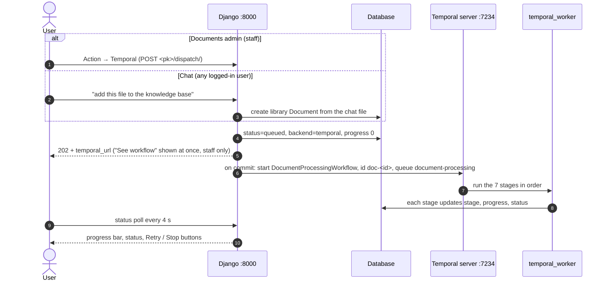
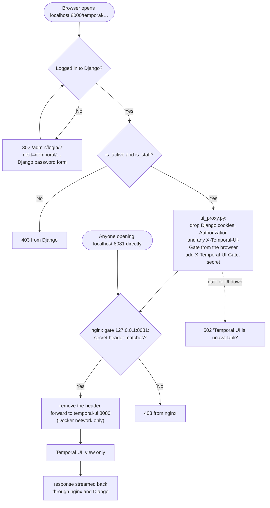
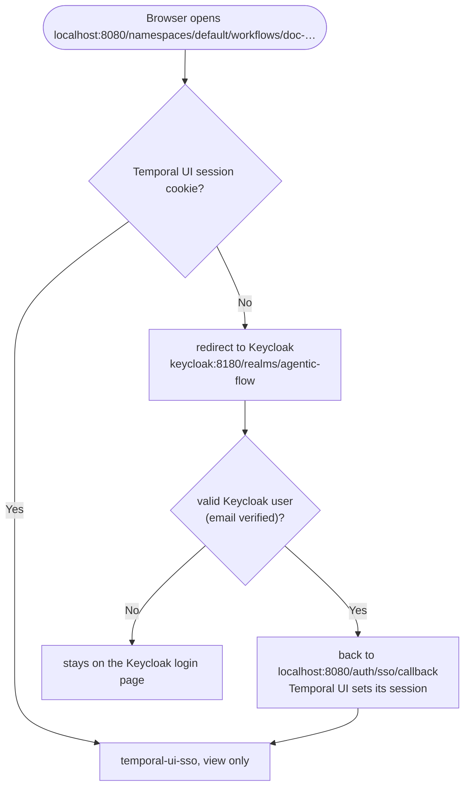

# Temporal: processing flow and UI access

How a document is processed by Temporal, and how the Temporal Web UI is
protected so only authorised people can open it.

**In short:**

- **Processing.** The documents admin (staff) or chat (any logged-in user)
  queues a document. Django starts one Temporal workflow per document,
  `doc-<document id>`, and the `temporal_worker` runs its seven stages.
- **UI access.** There are two Temporal UI containers, both view only and both
  reading the same Temporal server:
  - **Chat links → Django proxy.** `temporal-ui` has no login and no host
    port. The way in is `http://localhost:8000/temporal/`. Django checks the
    user is logged in and is active staff, then forwards the request with a
    secret header to an nginx gate on `127.0.0.1:8081`. The gate passes only
    requests carrying that secret on to Temporal UI.
  - **Documents admin links → Keycloak.** `temporal-ui-sso` is opened
    directly at `http://localhost:8080/` and uses Temporal UI's own OIDC login
    against Keycloak (`http://keycloak:8180`, realm `agentic-flow`).

```
Chat:            Browser ──► Django :8000 ──────────► nginx gate 127.0.0.1:8081 ──► temporal-ui (no host port) ──────┐
                             /temporal/* → ui_proxy    403 unless secret header      view only, under /temporal        │
                             login + staff check,                                                                    ├──► Temporal server
                             adds secret header                                                                      │    127.0.0.1:7234
Documents admin: Browser ──► temporal-ui-sso 127.0.0.1:8080 ─────────────────────────────────────────────────────────┘
                             view only, under /
                                   │ not logged in → redirect
                                   ▼
                             Keycloak keycloak:8180 (realm agentic-flow, client temporal-ui)
```

---

## 1. The pieces and where they run

| Piece | File | Runs in |
|---|---|---|
| Admin "Action → Temporal", Stop, Retry | `documents/admin.py` (`dispatch_view`, `temporal_cancel_view`, `temporal_retry_view`) | Django |
| Chat "add this file to the knowledge base" | `chat/services/file_commands.py` → `documents/controls.py` | Django |
| Queue a document | `documents/tasks.py → enqueue_document_processing` | Django |
| Start / query / terminate a workflow | `infrastructure/processing/temporal_backend.py` | Django |
| Workflow and its seven stage activities | `infrastructure/temporal/document_workflow.py` | `python manage.py temporal_worker` |
| Stage logic (extract, chunk, embed …) | `documents/services.py` | the worker |
| Staff-only UI proxy | `infrastructure/temporal/ui_proxy.py`, routed by `base/urls.py` (`temporal/`) | Django |
| nginx gate | `infrastructure/temporal/ui_gate.conf.template` | Docker `temporal-ui-gate` |
| Temporal UI for chat links (no login, behind the gate) | `temporalio/ui:2.34.0` | Docker `temporal-ui` |
| Temporal UI for documents admin links (Keycloak login) | `temporalio/ui:2.34.0` | Docker `temporal-ui-sso` |
| Keycloak (login for `temporal-ui-sso`) | `quay.io/keycloak/keycloak:26.0`, realm `infrastructure/keycloak/realm-agentic-flow.json` | Docker `keycloak` |
| Temporal server | `temporalio/auto-setup:1.24.2` | Docker `temporal` (+ `temporal-postgresql`) |

All Docker services are in `docker-compose.processing.yml`.

### Ports

| Port | What | Reachable from |
|---|---|---|
| `8000` | Django | the browser |
| `127.0.0.1:8081` | nginx gate (container port 8080) | this machine only; 403 without the secret |
| `8080` inside Docker | `temporal-ui` | the Docker network only (no host port) |
| `127.0.0.1:8080` | `temporal-ui-sso` | this machine only; redirects to Keycloak until logged in |
| `127.0.0.1:8180` | Keycloak (open as `http://keycloak:8180`) | this machine only |
| `127.0.0.1:7234` | Temporal server gRPC (container port 7233) | this machine only; used by Django and the worker (`TEMPORAL_HOST`) |

---

## 2. Processing flow: from click to "Processed"



### Step by step

1. **Start.**
   - **Admin:** a staff user picks **Action → Temporal**. `dispatch_view`
     resets the document and calls
     `enqueue_document_processing(pk, backend="temporal")`.
   - **Chat:** the `add_to_knowledge_base` tool (or the file panel) runs
     `file_commands.process_entries`. A chat file not yet in the library is
     copied into a new library `Document`, then `documents/controls.py`
     starts, resumes or reprocesses it, always with `backend="temporal"`.
2. **Queue.** `enqueue_document_processing` locks the row and sets
   `status=queued`, `processing_stage=queued`, `processing_progress=0`,
   `processing_backend=temporal`. The Temporal call is made only after the
   database transaction commits.
3. **Start the workflow.** `TemporalProcessingBackend.dispatch` connects to
   `TEMPORAL_HOST` and starts `DocumentProcessingWorkflow` with id
   `doc-<document id>` on task queue `document-processing`. The input is
   `{document_id, company_id, user_id, surface, backend}`.
4. **Answer the browser.** The admin gets `202` with `status_display`,
   `backend` and `temporal_url`, so the "See workflow" link appears straight
   away. Chat replies with the status and, for staff only, a workflow link.
5. **Run the stages.** `temporal_worker` runs the stages in this order:

   | # | Activity | Does |
   |---|---|---|
   | 1 | `stage_mark_processing` | sets `status=processing`, records the attempt (always runs) |
   | 2 | `stage_extract_text` | reads the file; OCR for scans and images (Tesseract, local) |
   | 3 | `stage_chunk_text` | splits the text into chunks |
   | 4 | `stage_delete_existing_chunks` | removes chunks from an earlier run |
   | 5 | `stage_embed_and_store_chunks` | embeds the chunks and stores them in the vector store |
   | 6 | `stage_mark_completed` | sets `status=ready` and the chunk count |
   | 7 | `stage_notify_completed` | final notification |

   Each activity has a 10-minute timeout and up to 3 attempts
   (`RetryPolicy(maximum_attempts=3)`). Every stage writes a `DocumentStage`
   row and updates the document's stage and progress.
6. **Follow progress.** The admin page polls the status endpoint every 4
   seconds (`status_poll.js`), updating the progress bar and status and
   showing Retry or Stop. Chat status replies read the same fields.
7. **Finish.** Success: status **Processed** at 100%. If a stage fails all 3
   attempts, the document is **Failed** and Retry appears.

### Stop and Retry (documents admin)

- **Stop** (`<pk>/temporal-cancel/`, queued or processing only). Terminates
  the workflow `doc-<id>` straight away and marks the document Failed with
  "Processing stopped by user." Completed stages and chunks are kept.
- **Retry** (`<pk>/temporal-retry/`, failed only). Starts a new run of
  `doc-<id>`. A stage that already has a completed `DocumentStage` row is
  skipped (except `stage_mark_processing`), so the run **resumes** at the
  stage that failed. A validation failure, such as a file that is too large,
  fails again unless the file or the limit changes.
- **Action → another backend.** The "See workflow" link is removed straight
  away, because the document is no longer on Temporal.

---

## 3. UI access flow

### Chat links: opening `/temporal/`



### Step by step (`infrastructure/temporal/ui_proxy.py`)

1. **Route.** `base/urls.py` sends every `/temporal/<path>` to
   `temporal_ui_proxy`.
2. **Login check.** Not logged in → redirect to `/admin/login/?next=…`, the
   normal Django admin login.
3. **Staff check.** Logged in but not `is_active and is_staff` → **403**.
   This is the check that decides who may see Temporal UI.
4. **Build the upstream URL.** `TEMPORAL_UI_URL` + `/temporal/<path>` +
   the query string, for example
   `http://localhost:8081/temporal/namespaces/default/workflows/doc-01M6…`.
5. **Clean the request.**
   - The `Cookie` header is rebuilt without Django's `sessionid`,
     `csrftoken` and `messages`, so Temporal UI never sees the Django session.
   - Not forwarded: `Authorization`, `Host`, `Content-Length`,
     `Accept-Encoding`, `Content-Encoding`, hop-by-hop headers, and any
     `X-Temporal-UI-Gate` the browser sent (a user cannot supply their own
     secret).
6. **Add the secret.** `X-Temporal-UI-Gate: <TEMPORAL_UI_PROXY_SECRET>`.
7. **Forward.** Same method and body, to the nginx gate; 5-second connect
   timeout, `TEMPORAL_UI_PROXY_TIMEOUT_SECONDS` (default 30) read timeout,
   redirects not followed.
8. **nginx gate.** Header missing or wrong → **403**. Correct → the header is
   removed and the request goes to `http://temporal-ui:8080` on the Docker
   network, with buffering off so pages stream.
9. **Temporal UI** answers. It runs under `/temporal`
   (`TEMPORAL_UI_PUBLIC_PATH`), so its paths match the proxied ones, and view
   only (`TEMPORAL_DISABLE_WRITE_ACTIONS=true`).
10. **Response.** Streamed back to the browser. A redirect pointing at the
    internal address is rewritten to stay on Django. Temporal's own
    `Set-Cookie` headers are passed through (never ones named like Django's).
11. **Errors.** Gate or UI unreachable → **502** "Temporal UI is unavailable".
    The rest of Django keeps working.

Only this view skips Django's CSRF check (`csrf_exempt`), because Temporal UI
checks CSRF itself.

### Why the nginx gate exists

Temporal UI has no login of its own, and anyone who can reach it sees every
workflow, including document, company and user IDs in the workflow inputs.
Django runs on the host, not in Docker, so it needs a host port to reach the
UI. Without the gate, any browser or program on this machine could open that
port and skip the Django login. So:

- `temporal-ui` has **no** `ports:` entry. Only containers on the Docker
  network can reach it.
- `temporal-ui-gate` (`nginx:1.27-alpine`) is the only thing published for
  it, on `127.0.0.1:8081`, so other machines cannot reach it either.
- At start-up, the nginx image fills `${TEMPORAL_UI_PROXY_SECRET}` into the
  config from the container environment, which Compose takes from `.env`.
  Only Django's proxy knows the secret, and it adds it only after the staff
  check.

### Documents admin links: Keycloak (`temporal-ui-sso`)



1. **Link.** Every workflow link in the documents admin is built by
   `chat/services/kb.py → temporal_sso_ui_url` as
   `TEMPORAL_UI_SSO_URL/namespaces/default/workflows/doc-<document id>`.
2. **Login.** `temporal-ui-sso` runs with `TEMPORAL_AUTH_ENABLED=true`. With
   no session it redirects to Keycloak (client `temporal-ui`, secret
   `TEMPORAL_UI_CLIENT_SECRET`), which sends the user back to
   `http://localhost:8080/auth/sso/callback`.
3. **Same address everywhere.** The browser and the container must reach
   Keycloak at the same issuer URL, `http://keycloak:8180`. Keycloak listens on
   8180 inside Docker too (`KC_HTTP_PORT`, `KC_HOSTNAME`), and the host needs
   `127.0.0.1 keycloak` in `/etc/hosts`.
4. **Who gets in.** Temporal UI checks only that the login succeeded; it has
   no roles. **Any user in the `agentic-flow` realm can see every workflow**,
   so the realm's user list is the access list. Django's `is_staff` plays no
   part on this path.
5. **Users.** Keycloak admin console `http://keycloak:8180` (user `admin`,
   password `KEYCLOAK_ADMIN_PASSWORD`) → realm **agentic-flow** → **Users** →
   add user with **Email verified** on → **Credentials** → password with
   **Temporary** off. Remove access by disabling or deleting the user.

---

## 4. Who can do what

| Django user | Start processing | See progress | Temporal UI from chat (`/temporal/`) |
|---|---|---|---|
| Not staff | from chat (always Temporal) | in chat | **No**: no links shown; `/temporal/…` gives 403 |
| `is_staff` | from chat or the documents admin (any backend) | chat and admin | Yes, view only |
| `is_staff` + `is_superuser` | same | same | Yes, view only |

- Give or remove chat-path access in **Admin → Users → Staff status**, or
  create a staff account with `python manage.py createsuperuser`. The proxy
  checks `is_staff` on every request, so a change applies on the next page
  load.
- The documents admin links (`localhost:8080`) need a **Keycloak** user in the
  `agentic-flow` realm instead (section 3). The two lists are separate:
  removing staff status does not remove Keycloak access, and the reverse.
- A non-staff chat user sees the workflow id as text in status replies
  (`workflow: doc-…`). Knowing it gives no access.

### Where the Temporal links appear

| Place | Source | Opens | Shown to |
|---|---|---|---|
| Admin header, "Temporal workflows" | `base/templates/unfold/helpers/userlinks.html` | `/temporal/` (proxy) | active staff |
| Documents admin, "See workflow", info popup | `documents/admin.py → temporal_link` on page load; `schedule_dropdown.js` right after dispatch; `status_poll.js` as a fallback; `temporal_info.js` | `localhost:8080` (Keycloak) | staff (the admin is staff only) |
| Chat replies and file panel, "Workflow" | `chat/services/file_commands.py`, `session_files.py`; drawn by `chat/templates/chat/chat_page.html` | `/temporal/` (proxy) | active staff (`data-can-view-temporal`) |

Links are built in `chat/services/kb.py`:

- `temporal_ui_url` → `/temporal/namespaces/default/workflows/doc-<document id>`
  (chat and the admin header).
- `temporal_sso_ui_url` →
  `TEMPORAL_UI_SSO_URL/namespaces/default/workflows/doc-<document id>`. The
  documents admin imports it under the name `temporal_ui_url`, so its code
  is unchanged.

Hiding a link is cosmetic. The staff check plus the nginx gate, and the
Keycloak login, are what block access.

---

## 5. Run it locally

```bash
# Once per machine: the Keycloak issuer name must resolve for the browser
echo "127.0.0.1 keycloak" | sudo tee -a /etc/hosts

# Temporal server + Postgres, both Temporal UIs, nginx gate, Keycloak (and Kafka)
docker compose -f docker-compose.processing.yml up -d

# Worker that runs the workflow stages
python manage.py temporal_worker

# Django
python manage.py runserver
```

| Open | Result |
|---|---|
| http://localhost:8000/admin/ | Django admin |
| **http://localhost:8000/temporal/** | Temporal UI via the proxy (staff only); used by chat links |
| **http://localhost:8080/** | Temporal UI with Keycloak login; used by documents admin links |
| http://keycloak:8180/ | Keycloak admin console (manage users in realm `agentic-flow`) |
| http://localhost:8081/temporal/ | **403** from the gate, always, even when logged in |

After changing `.env`, fully restart `runserver` and the worker. The
auto-reloader does not pick up `.env` changes.

### Settings (`.env`)

| Variable | Local value | Meaning |
|---|---|---|
| `TEMPORAL_HOST` | `localhost:7234` | Temporal server gRPC, used by Django and the worker |
| `TEMPORAL_UI_URL` | `http://localhost:8081` | the nginx gate; used only by the proxy |
| `TEMPORAL_UI_PROXY_SECRET` | *(random)* | shared by the proxy and the gate container; without it every Temporal page is 403. Never commit it. |
| `TEMPORAL_UI_SSO_URL` | `http://localhost:8080` | `temporal-ui-sso`; base of the documents admin workflow links |
| `TEMPORAL_UI_CLIENT_SECRET` | *(random)* | Keycloak client `temporal-ui` secret, read by both `keycloak` (realm import) and `temporal-ui-sso`. Never commit it. |
| `KEYCLOAK_ADMIN_PASSWORD` | *(random)* | Keycloak admin console password (user `KEYCLOAK_ADMIN_USER`, default `admin`); used only on Keycloak's first start |
| `TEMPORAL_UI_PROXY_TIMEOUT_SECONDS` | `30` (default) | how long the proxy waits for Temporal UI |
| `SESSION_COOKIE_SECURE` / `CSRF_COOKIE_SECURE` | `False` | default `True`; `False` only for plain-http local development |
| `USE_X_FORWARDED_PROTO` | unset | `True` only behind an HTTPS proxy that sets this header |

After changing `TEMPORAL_UI_PROXY_SECRET`, run
`docker compose -f docker-compose.processing.yml up -d` (so the gate gets it)
and restart `runserver`.

---

## 6. Checks

| # | Do | Expected |
|---|---|---|
| 1 | Open `/temporal/` in a private window | Django login, then Temporal UI |
| 2 | Log in as a user without staff status, open `/temporal/` | 403 |
| 3 | Log in as staff, open `/temporal/` | workflows listed |
| 4 | Admin: **Action → Temporal** on a document | "See workflow" appears straight away; progress moves; Processed at the end |
| 5 | Press **Stop** while it runs | Failed, "Processing stopped by user."; workflow terminated |
| 6 | Press **Retry** | resumes at the stage that failed |
| 7 | `curl -i http://localhost:8081/temporal/` | 403 from nginx |
| 8 | From another machine: `curl http://<server-ip>:8080/` or `:8081/` | connection refused |
| 9 | Stop the `temporal-ui` container, open `/temporal/` | 502; Django still works |
| 10 | Documents admin: click "Workflow" in a private window | Keycloak login, then the workflow on `localhost:8080` |
| 11 | Chat: click a "Workflow" link | opens `/temporal/…`, no Keycloak prompt |
| 12 | `curl -i http://localhost:8080/` | redirect towards Keycloak, not the UI |

---

## 7. Troubleshooting

| Problem | Cause / fix |
|---|---|
| Stays **Queued** forever | `temporal_worker` is not running, or `TEMPORAL_HOST` is wrong. Start the worker. |
| `/temporal/` shows a blank white page | Temporal UI older than 2.27 breaks under `/temporal` (its CSP blocks its own startup script). Use `temporalio/ui:2.34.0` or newer; hard-refresh. |
| `localhost:8081` shows 403 | Expected. Use `localhost:8000/temporal/`. |
| Admin "Workflow" link: browser can't find `keycloak` | Add `127.0.0.1 keycloak` to `/etc/hosts`. |
| Keycloak says "Invalid parameter: redirect_uri" | The client's redirect URI must be exactly `http://localhost:8080/auth/sso/callback`. Fix it in the realm file (and the client in the Keycloak console, since the realm is imported only on first start). |
| `temporal-ui-sso` login fails / issuer mismatch | Keycloak must be `http://keycloak:8180` for both browser and container (`KC_HOSTNAME`, `KC_HTTP_PORT`). Check `docker compose -f docker-compose.processing.yml logs keycloak temporal-ui-sso`. |
| Keycloak login loops on "verify your email" | Edit the user in the Keycloak console and turn **Email verified** on. |
| `localhost:8000/temporal/` gives 403 for a staff user | `TEMPORAL_UI_PROXY_SECRET` missing or different between `.env` and the gate. Restart `runserver` and run `docker compose -f docker-compose.processing.yml up -d`. |
| "See workflow" does not appear after dispatch | Hard-refresh (Ctrl+Shift+R) so the browser loads the current `schedule_dropdown.js`. |
| Login does nothing / admin forms fail on http | `SESSION_COOKIE_SECURE` / `CSRF_COOKIE_SECURE` are `True` on plain http. Set them to `False` locally. |
| 405 in the browser console on a workflow page | Normal: write actions are disabled, so Temporal UI refuses its metadata query. |
| 502 "Temporal UI is unavailable" | `docker compose -f docker-compose.processing.yml up -d temporal-ui temporal-ui-gate` |

---

## 8. Production notes

- Never publish 8081 or 7234 publicly, and never point a public nginx route
  at 8081; the public route for chat links is Django's `/temporal/`.
  Docker-published ports bypass `ufw`, so keep the `127.0.0.1:` prefix.
- To open `temporal-ui-sso` (8080) from other machines, serve it and Keycloak
  over HTTPS on real hostnames, and update `TEMPORAL_AUTH_CALLBACK_URL`,
  `TEMPORAL_AUTH_PROVIDER_URL`, `KC_HOSTNAME`, `TEMPORAL_UI_SSO_URL` and the
  client's redirect URI to match. Run Keycloak in production mode (`start`,
  not `start-dev`).
- Use a fresh `TEMPORAL_UI_PROXY_SECRET` and `TEMPORAL_UI_CLIENT_SECRET` per
  environment. If Django runs inside the same Docker network, drop the gate's
  host port and set `TEMPORAL_UI_URL=http://temporal-ui-gate:8080`.
- Serve the site over HTTPS only. Keep the secure-cookie settings at `True`,
  and set `USE_X_FORWARDED_PROTO=True` behind a proxy.
- Kafka's `9093` is still public in `docker-compose.processing.yml`; bind it to
  `127.0.0.1` as well.
- Review who has staff status, and who is in the Keycloak `agentic-flow`
  realm, regularly.
