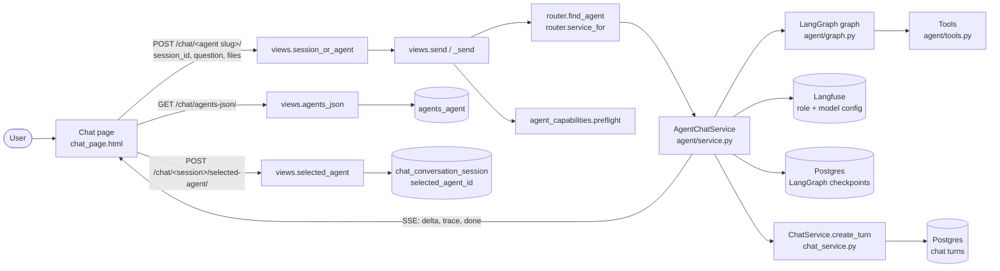
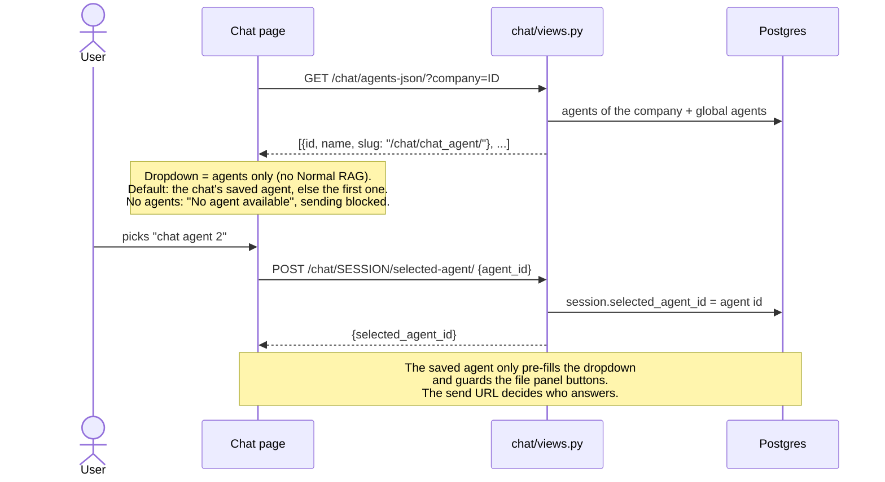
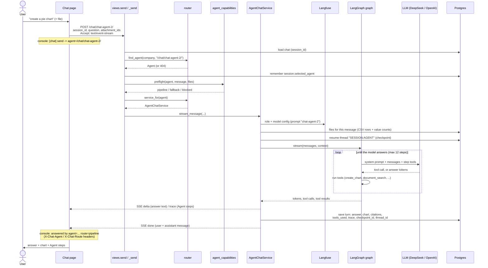
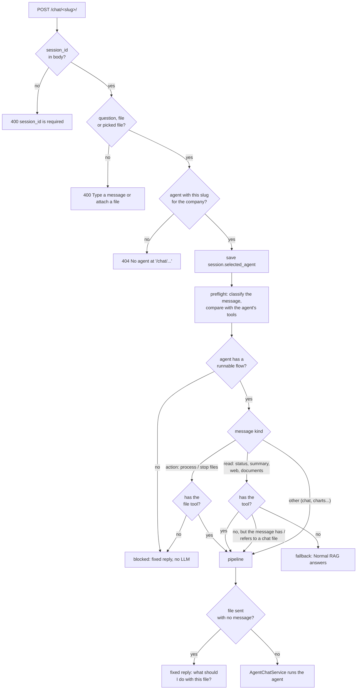
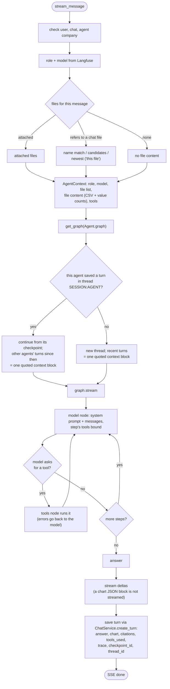
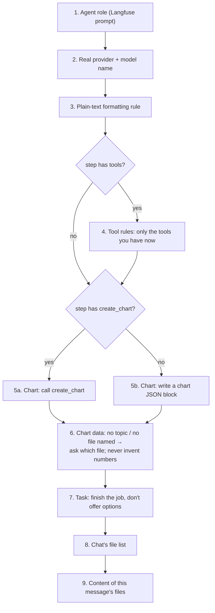
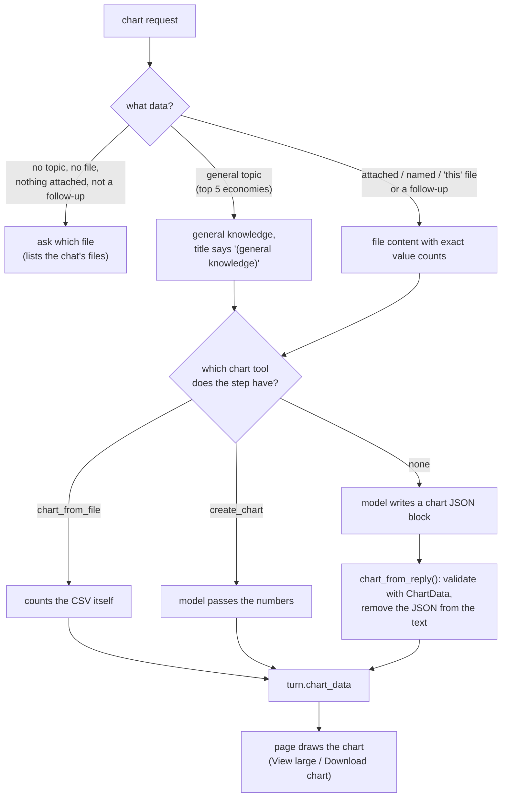
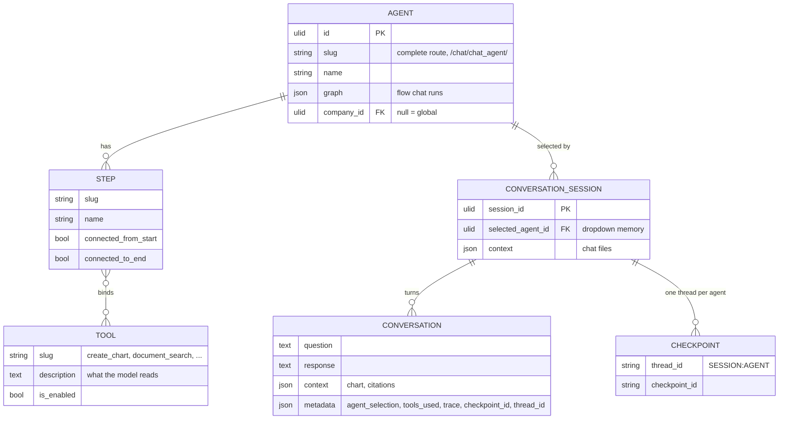

# Chat and agent flow: diagrams

Diagrams of the current chat flow. The text version, with every step
explained, is [CHAT_AND_AGENT_FLOW.md](CHAT_AND_AGENT_FLOW.md).

The diagrams are Mermaid. They render on GitHub/GitLab and in VS Code with a
Mermaid preview extension (for example "Markdown Preview Mermaid Support").

> Normal RAG is hidden in the chat page for now: every message goes to an agent.

---

## 1. The big picture

---

## 2. Choosing an agent in the page

---

## 3. Sending a message (end to end)

---

## 4. Which path answers (capability check)

---

## 5. Inside the agent run

---

## 6. The system prompt, in order

---

## 7. How a chart is made

---

## 8. Data that is stored

The agent's role text and model config are not in the database: they are the
Langfuse prompt named after the slug's name part (`chat_agent`).
